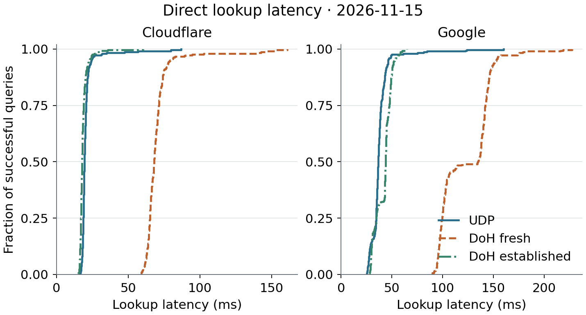
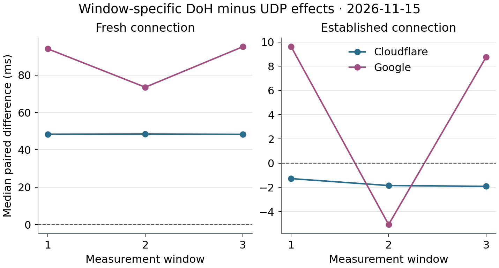
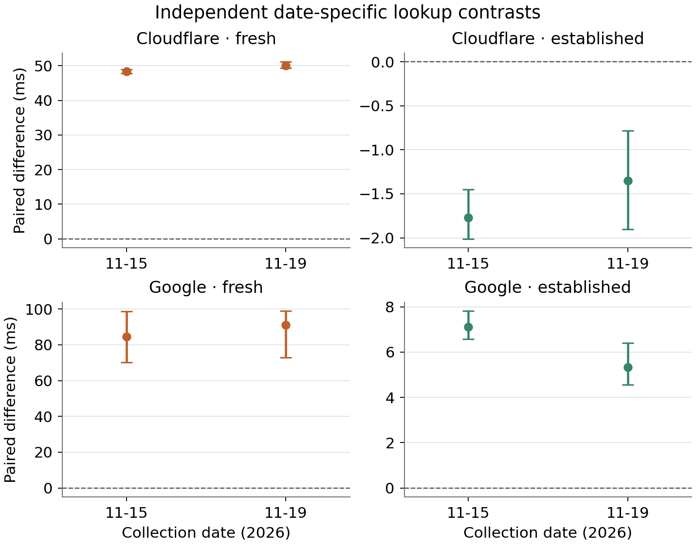
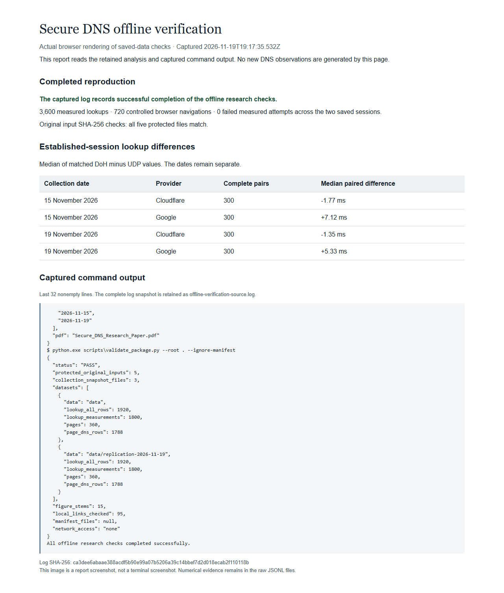
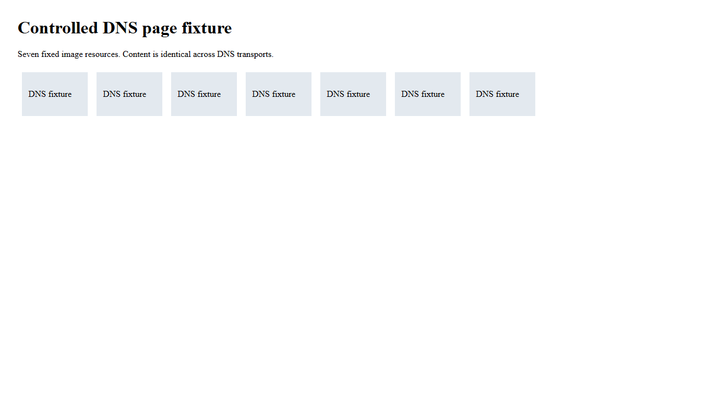
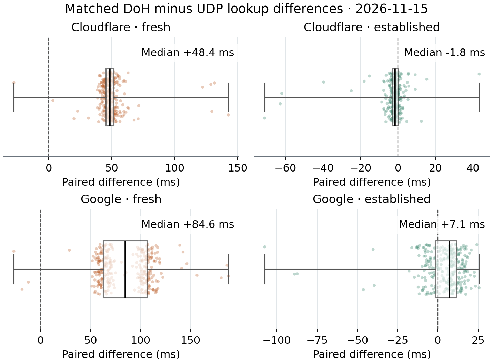
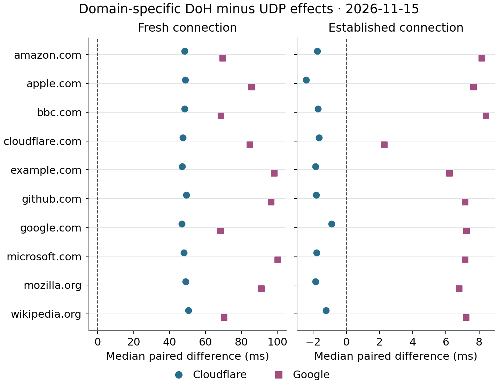
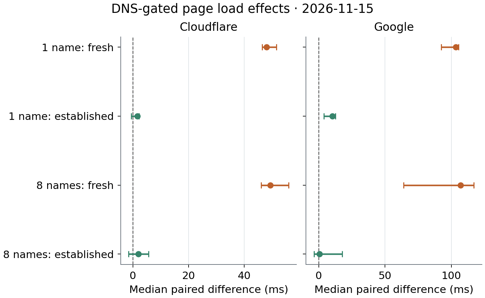
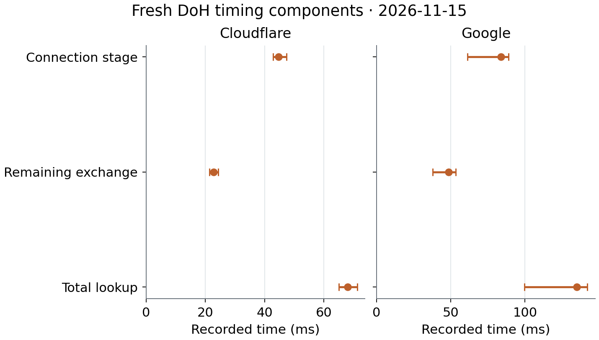
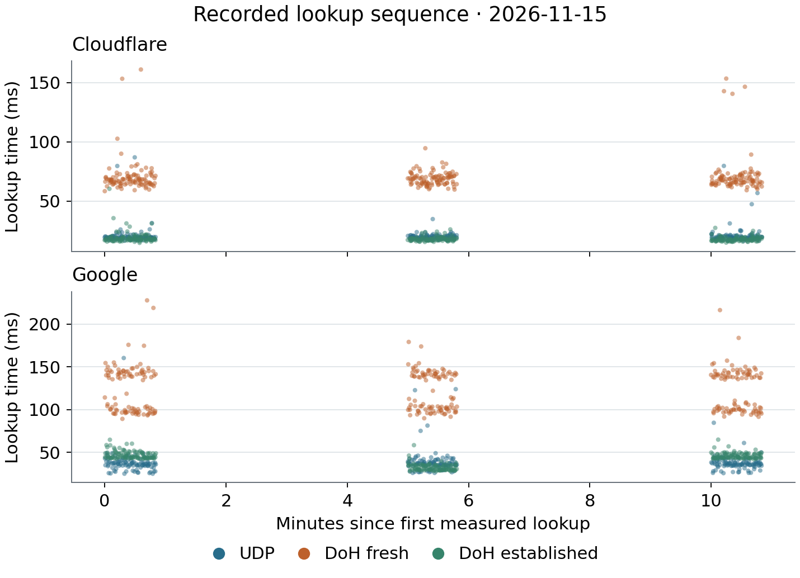

# Secure DNS lookup and page load measurements

**Emirhan TEKBAŞ · Student ID 75831 · Computer Engineering · Vistula University**

Architecture of Computers (CII3SE003CI), 2026/2027

This project compares standard UDP DNS with DNS over HTTPS using the **same provider**, while separating a **fresh HTTPS connection** from an **established connection**. Cloudflare and Google are measured independently. A controlled browser fixture examines how live DNS waiting affects a fixed page with one or eight hostnames.

The original measurements were collected on **15 November 2026**. A separate **19 November 2026** replication repeats the workload with a different randomization seed. The dates remain separate throughout the analysis. Read the [paper PDF](Secure_DNS_Research_Paper.pdf) or the [illustrated manuscript](manuscript.md).

## Research question

How much of the DoH lookup difference remains after connection setup is excluded, how sensitive is that difference to the window and date, and how does DNS waiting propagate through a fixed browser resource graph?

This is an introductory replication and controlled comparison. It does not propose a new transport or claim a worldwide provider ranking.

## Main observations

The original session contains **1,800 measured lookups and 360 browser navigations**, with priming records retained separately.

| Original session, 15 November | UDP median | Fresh DoH median | Established DoH median | Established paired difference |
|---|---:|---:|---:|---:|
| Cloudflare | 19.5 ms | 68.1 ms | 17.8 ms | −1.8 ms |
| Google | 36.5 ms | 134.9 ms | 43.8 ms | +7.1 ms |

The last column is the **median of matched differences**, not subtraction of the marginal medians. Google's established-session contrast changed from **+9.6 ms to −5.1 ms to +8.7 ms** across the original windows. A pooled estimate conceals that sensitivity.







See [extended results](docs/RESULTS.md) for the second-date values, condition counts, failures and sensitivity analyses. Primary intervals condition on observed windows. Domain-cluster resampling is an additional check, not a correction for unmeasured routing or time dependence.

## What distinguishes this comparison

| Control | Purpose | Remaining uncertainty |
|---|---|---|
| Same operator and pinned provider IP | Reduces an infrastructure change in the baseline | Anycast site, front end and cache may differ |
| Recorded HTTP/2, TLS and connection state | Verifies fresh and established treatments | Client and service costs remain combined |
| Matched randomized blocks | Compares the same provider, name, window and repetition | Conditions may change between adjacent queries |
| Separate windows and collection dates | Exposes changes concealed by one average | Two dates and one host are not a population sample |
| Independent saved-message decoding | Makes response validity auditable | Does not identify resolver cache hits |
| Fixed browser resource graph | Separates DNS gating from changing content | Excludes native browser DNS and remote transfer |

These controls adapt established methods. The [literature review](docs/LITERATURE_REVIEW.md) compares earlier studies; [discussion arguments](docs/DISCUSSION_ARGUMENTS.md) explain defensible claims. The [source audit](docs/SOURCE_AUDIT.md) ties references to specific passages and boundaries.

## Reproduce the saved results

Use Python 3.12 or later and a compatible Node.js installation. From the repository root:

```powershell
python -m pip install -r requirements.txt
python scripts/reproduce.py
```

The command runs local tests, audits saved packets and treatment conditions, analyzes each date separately, creates robustness tables and figures, and rebuilds the paper. It **does not collect new Internet measurements**. Dependency installation needs Internet access; the saved-data pipeline is offline once dependencies are installed.

Measured values, intervals and plots should reproduce from the retained inputs. Generation timestamps may change. [Reproduction details](docs/REPRODUCIBILITY.md) provide individual commands, expected outputs and failure handling.

## Execution evidence

This actual browser screenshot shows the offline verification report containing captured command output and data-derived checks. It is not a command-line terminal screenshot. The text log is retained alongside the image.



The following screenshot shows the actual fixed browser fixture after a successful live-DNS-gated load. Its evidence run is separate from the analyzed samples.



[Capture metadata and logs](docs/evidence/README.md) identify execution times and page identifiers. Screenshots document execution and appearance; raw JSONL remains the numerical evidence.

## Further analysis











The setup plot is descriptive; it does not isolate encryption cost. All valid observations are retained. p95 from thirty page observations is an unstable descriptive tail estimate.

## Repository structure

```text
.
├── README.md
├── manuscript.md
├── Secure_DNS_Research_Paper.pdf
├── scripts/                    # Collection, analysis, plots, checks and paper builder
├── tests/                      # Local research-property and packet tests
├── data/                       # Immutable original measurements and metadata
│   └── replication-2026-11-19/  # Separately retained second-date data
├── results/                    # Original summaries and sensitivity tables
│   └── replication-2026-11-19/  # Second-date summaries
├── figures/                    # PNG and vector scientific plots
├── docs/                       # Methods, literature, limitations and evidence
├── package.json
├── package-lock.json
├── requirements.txt
├── profile.json
└── SHA256SUMS.txt
```

## Collect a new replication

New measurements require outbound UDP 53 and TCP 443 to the providers, plus installed Google Chrome for the browser fixture. Collectors do not change operating system DNS settings. Install the pinned browser library with `npm ci`, then follow [the collection procedure](docs/REPRODUCIBILITY.md#collect-an-independent-replication). Use fresh output directories and retain all attempts. Do not overwrite the distributed raw data.

## Interpretation boundaries

Remote cache state is unknown. Prewarming encourages reuse without proving hits or misses. The same provider and IP do not prove identical physical infrastructure.

The browser fixture validates DNS answers but **does not contact their addresses**. Playwright delivers fixed local content after DNS completes. This is a controlled dependency experiment, rather than native browser DoH or real website loading. Load-event time is not visual completeness or interactivity. CPU cycles and energy were not measured.

Read [the limitations](docs/LIMITATIONS.md) before generalizing. The assessed PDF contains the required research declarations and the evidence-repository URL.
