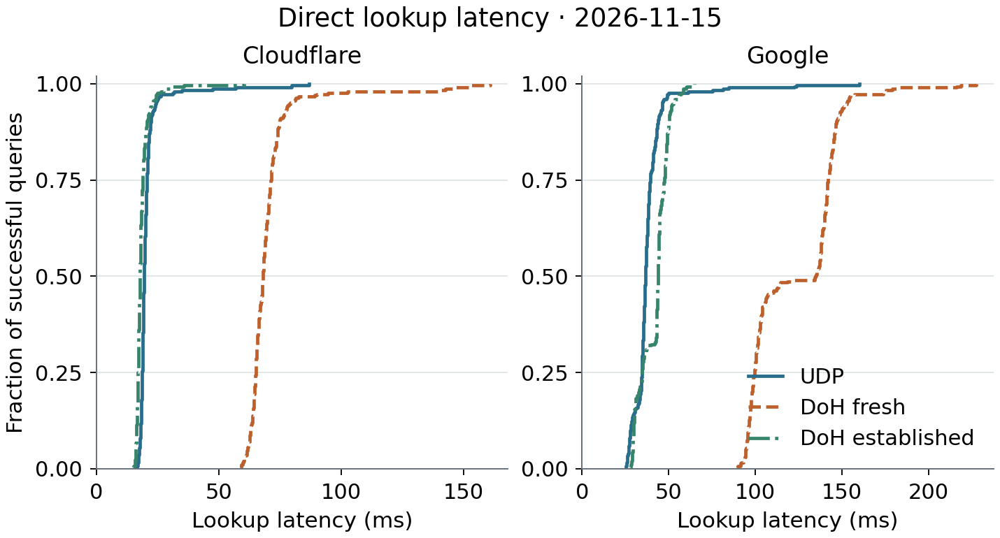
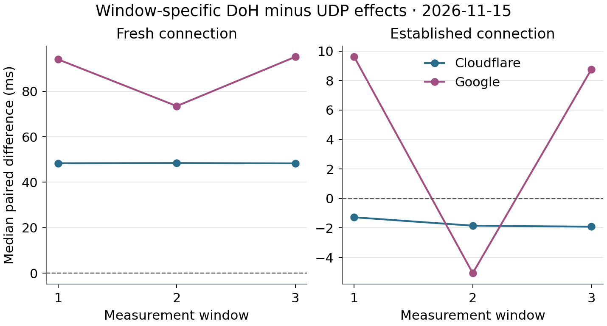
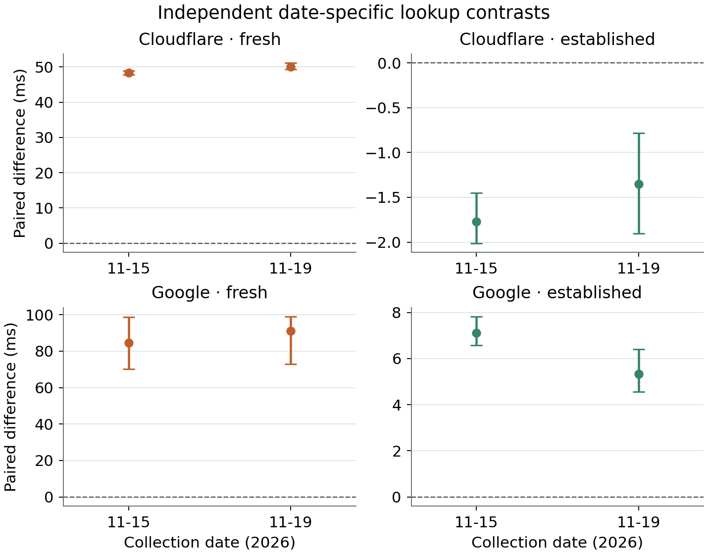
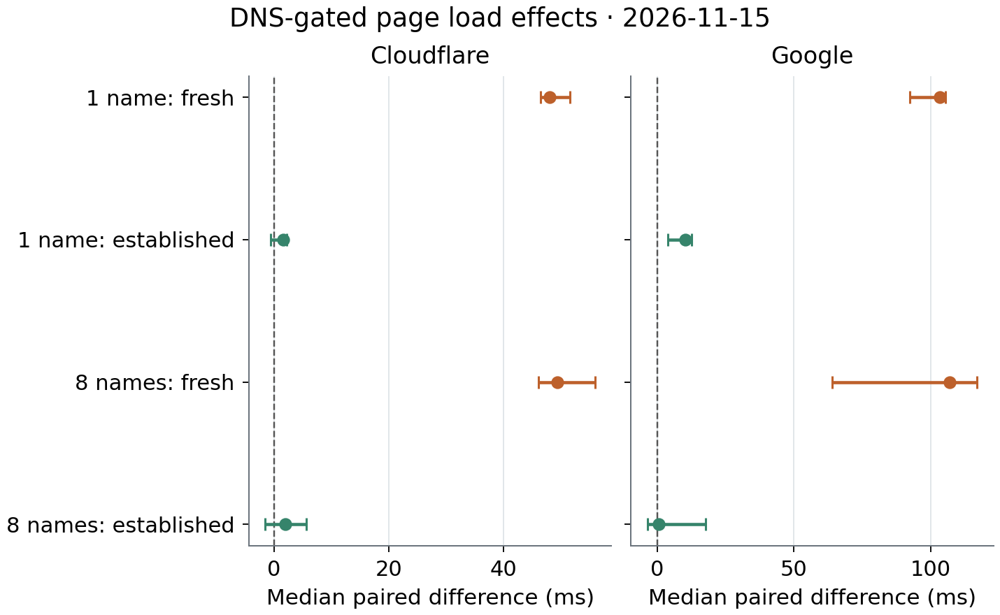

# Performance Overhead of Secure DNS

## Evaluating Lookup Latency and Page Load Impact of DNS over HTTPS Versus Standard UDP DNS

{{IDENTITY}}

### Abstract

DNS over HTTPS (DoH) protects communication with a recursive resolver, but its performance depends on connection state and the surrounding workload. This study asks whether a single overhead estimate remains informative when provider choice, connection reuse and measurement time are considered explicitly. A same-provider replication compares IPv4 A queries through UDP DNS, fresh HTTP/2 DoH and established HTTP/2 DoH using Cloudflare and Google. The original session on 15 November 2026 contains 1,800 measured lookups and 360 controlled browser navigations. An independent session on 19 November repeats the workload with a different randomization seed, producing {{REPLICATION_COUNTS}}. Direct wire queries bypass the operating system cache; remote recursive cache state remains unknown despite prewarming. Socket metadata verifies HTTP/2, TLS version, connection state and absence of TLS resumption. Each browser request waits for live DNS before fixed local content is delivered, with one or eight hostnames and seven images. Returned addresses are deliberately not contacted. The original median paired fresh-DoH differences were {{ABSTRACT_FRESH}}. Established-session differences were {{ABSTRACT_WARM}}. {{ABSTRACT_REPLICATION}} Domain-cluster resampling, individual windows and a second collection date test how dependent the interpretation is on aggregation choices. The browser fixture demonstrates DNS gating under a fixed dependency graph, while excluding native browser resolution and remote website transfer. Connection establishment is therefore a separate experimental treatment, and an isolated lookup difference is insufficient to predict general page performance. The contribution is an auditable replication with explicit validity boundaries, rather than a new transport or a universal provider ranking.

Keywords: DNS over HTTPS; connection reuse; lookup latency; page load time; reproducibility

## Introduction and related work

DNS resolution can sit on the critical path before an application contacts a server. Conventional DNS messages commonly use UDP port 53 (Mockapetris, 1987). DoH instead maps a DNS exchange onto HTTPS, adding connection management and transport protection (Hoffman & McManus, 2018). The resulting delay includes network waits and software handling. An elapsed-time comparison cannot identify processor cycles spent on encryption. Le Louët et al. (2024), who measured resolver CPU and memory as well as response time, illustrate why those are separate outcomes.

The approved question is narrowed into three comparisons: how connection state changes same-provider lookup latency; whether the sign of an established-session contrast persists across windows and collection dates; and how DNS waiting propagates through a controlled browser resource graph. The practical decision is whether a workload can amortize HTTPS setup, rather than whether every encrypted lookup carries one fixed penalty.

Chhabra et al. (2021) studied worldwide performance using default resolvers as the conventional-DNS baseline. Changing operators can affect that comparison. Their authoritative-zone cache-miss method also differs from clearing a local cache. Böttger et al. (2019) and Hounsel et al. (2020) separated query latency from browser loading, while Hounsel et al. (2021) separated setup from established-session queries. This study re-tests those distinctions with pinned provider endpoints, paired observations and retained raw messages. It does not claim that connection reuse or same-provider controls are new discoveries.

{{LITERATURE_CONTEXT}}

The distinguishing evidence is the combination of verified transport treatments, observed changes of sign, two separately analyzed dates, and a browser fixture whose exclusions are explicit. A larger bibliography alone would not establish that contribution. Table and figure values are generated from saved attempts, with an offline reproduction command and a source-to-claim audit trail.

## Methodology

### Apparatus and resolver controls

{{ENVIRONMENT}}

Cloudflare used 1.1.1.1 with cloudflare-dns.com/dns-query; Google used 8.8.8.8 with dns.google/dns-query. DoH connected to the pinned provider address while preserving TLS hostname and certificate verification. Endpoint bootstrap was excluded. Equivalent queries requested A records over IPv4 with recursion desired, without EDNS or a DNSSEC request bit. Binary POST used application/dns-message, and HTTP/2 negotiation was required (Hoffman & McManus, 2018; Thomson & Benfield, 2022).

Provider identity and destination IP reduce operator differences but cannot prove identical anycast routes, internal front ends or recursive caches. {{CACHE_AND_ANYCAST_CITATION}} Direct messages bypass local stub-cache APIs. Before each lookup window, the ten names were primed through UDP and the persistent DoH client. This encourages reuse without proving cache hits. TTLs were saved as diagnostics. A local cache flush would not clear a public resolver's cache, and no verified recursive-cache-miss treatment is claimed.

### Lookup and browser procedures

The lookup names were example.com, wikipedia.org, mozilla.org, github.com, cloudflare.com, google.com, microsoft.com, apple.com, bbc.com and amazon.com. Each provider-name-repetition block randomized UDP, fresh DoH and established DoH. Ten repetitions in three windows yielded 300 attempts per provider-treatment condition per date. DNS windows began five minutes apart. Dates were analyzed separately. Seeds were 20261115 and 20261119; neither session was externally preregistered.

UDP timing began before socket creation. DoH timing began after message encoding and included lazy connection setup when required. Both ended after complete-response validation. Fresh lookup trials created a new TCP/TLS/HTTP/2 client per query; established trials reused a primed session for the provider and window. TLS resumption and connection state were recorded. There were no retries; connection and query stages each had a three-second timeout. These are client-and-service timings, not pure cryptographic costs.

Each page had one HTML document and seven fixed SVG images. One layout used one hostname; the other used eight. An in-flight promise memoized each hostname's live DNS request. Playwright fulfilled requests with fixed bytes after valid DNS, without contacting the returned addresses. New browser contexts blocked service workers. Fresh page DoH paid setup once per navigation and shared that connection across names; established page DoH opened and primed the connection before navigation using a name outside the fixture workload. Page hostname sets received equal UDP prewarming before each window. The exact layout and payload generator are included in the repository.

Ten randomized navigation triplets per provider and layout in three windows yielded thirty attempts per condition per date. The primary metric was loadEventEnd minus startTime, read after the load event completed (Weiss & Rosenthal, 2026). Success required seven loaded images, the expected hostname count, valid DNS and consistent connection metadata. This measures a DNS-gated fixture, not the browser's native resolver, real-site TLS or Internet content transfer.

### Validation and uncertainty

Checks covered response identity, question, response flag, opcode, truncation, response code and A answers; DoH also required HTTP 200 and the DNS media type. A second decoder audited saved query/response bytes. Per-page query numbering and unchanged connection metadata checked reuse. Failures stayed in attempt counts and were excluded only from successful-latency summaries. No timeout was imputed as a successful observation.

Medians, interquartile ranges and nearest-rank p95 describe successful attempts. The primary contrast is the median paired DoH-minus-UDP difference. Descriptive percentile intervals use 4,000 paired bootstrap samples within observed windows. Sensitivity analyses retain individual windows, omit one window at a time, and resample whole domain clusters. {{STATISTICS_CITATION}} The latter preserves within-domain dependence but has only ten clusters. No interval corrects unmeasured routing or cache bias, and dates are not pooled into a universal effect.

## Results

### Completeness and lookup distributions

{{COMPLETENESS}}

{{LOOKUP_TABLE}}

Figure 1. Empirical distributions from 15 November. Fresh DoH includes connection setup. All successful observations are retained; the figure uses the recorded sample, not results from prior publications.

{{PRIMARY_LOOKUP_RESULTS}}

### Window and collection-date sensitivity

{{WINDOW_RESULTS}}

Figure 2. Original-session median paired differences by window. Positive values indicate slower DoH. Individual-window estimates expose variation concealed by a pooled median.

{{REPLICATION_RESULTS}}

Figure 3. Separately analyzed collection dates. These are date-conditioned client-and-service contrasts, not causal effects of the calendar date. The accompanying tables retain sample counts and failure information.

{{ROBUSTNESS_RESULTS}}

### Controlled browser loads

{{PAGE_RESULTS}}

Figure 4. Original-session paired load-event differences for one and eight hostnames. Intervals condition on the observed windows and successful page pairs. One fresh connection is shared within a page.

{{REPLICATION_PAGE_RESULTS}}

Full marginal, paired, domain and date-specific tables, additional graphs and the fixture screenshot are provided in the repository's extended results. Screenshots document execution and appearance; they do not replace raw measurements.

## Discussion

The fresh-versus-established distinction changes the answer substantially. A request that creates an HTTPS connection differs from a service that reuses one. A small or negative established-session contrast cannot establish that encryption accelerates DNS: routing, front ends, caching and client handling remain alternative explanations. The observed Google sign change is therefore evidence against reporting a context-free overhead, rather than evidence of a universally faster protocol.

A second collection date strengthens the audit by repeating the workload, but does not create a representative longitudinal sample. Browser and runtime metadata are retained for each session. Unmeasured access-link and routing changes can accompany the date. Agreement supports only repeatability under the sampled conditions; disagreement is reported rather than averaged away.

The browser fixture separates a mechanism from a deployment claim. Its main-document lookup precedes parsing; subsequent distinct-name lookups may overlap. Seven images therefore do not imply seven serial DNS waits. Native browsers also introduce caching, prefetching, address racing, connection coalescing and fallback, while content servers add TLS and transfer variability. The fixture removes those effects, so its observed load time cannot rank real websites or replace the native-browser measurements in Hounsel et al. (2020).

The contribution relative to a simple benchmark is inspectability: semantic query equivalence, explicit connection treatments, raw-wire validation, paired windows, a separate-date replication and alternative resampling units. It remains an introductory replication. No new protocol, global provider ordering, controlled recursive-cache treatment or processor-overhead estimate is claimed.

Relative to Chhabra et al. (2021), the narrower provider-matched baseline reduces an operator change but sacrifices global coverage and controlled cache misses. Relative to native-browser studies, fixed bytes improve control of content while limiting deployment validity. The repeated sign reversal makes these tradeoffs visible: precision within a sampled workload should not be confused with stability across network contexts. A defensible implementation recommendation is to measure the application's actual connection lifetime and dependency graph before transferring a benchmark number into a user-experience claim.

The next experiment should sample additional networks and full time-of-day cycles, verify native-browser DNS with network traces, and include HTTP/3 or DoQ as separately defined treatments. Server resource measurement would answer the architecture question raised by Le Louët et al. (2024); application latency alone cannot answer it.

## Conclusion

{{CONCLUSION_RESULTS}} Connection state, measurement context and the resource dependency graph must accompany any reported DoH penalty. The package makes those qualifications checkable through raw evidence and one-command offline reproduction.

## Declaration of Generative AI and AI-Assisted Technologies

OpenAI Codex assisted with design, source discovery, code, measurement execution, analysis and drafting. Automated checks audited responses and recalculated results. The submitting author remains responsible for independent verification, understanding and the final interpretation.

## Data and code availability

Code, raw measurements, environment metadata, figures and execution evidence: {{REPOSITORY_URL}}. Original and replication data remain separate. {{REPRODUCIBILITY_CITATION}}

## References

{{REFERENCES}}
