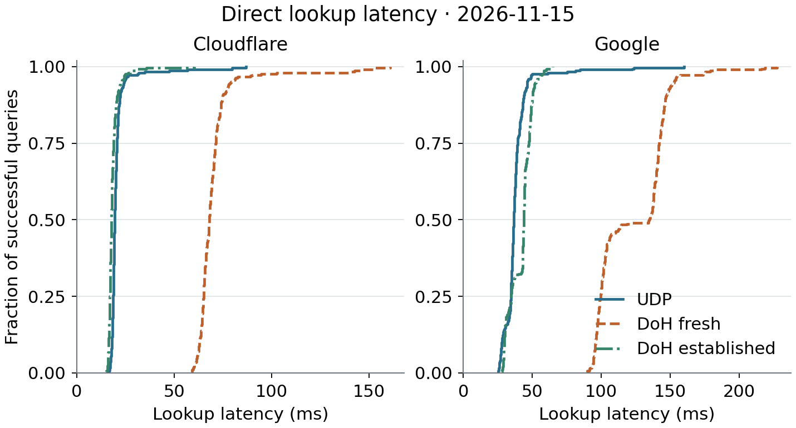
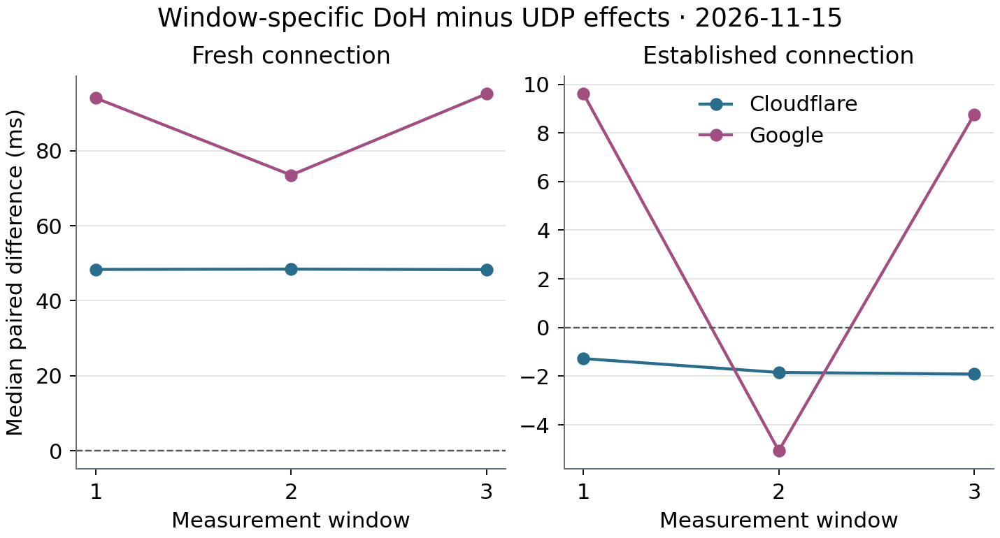
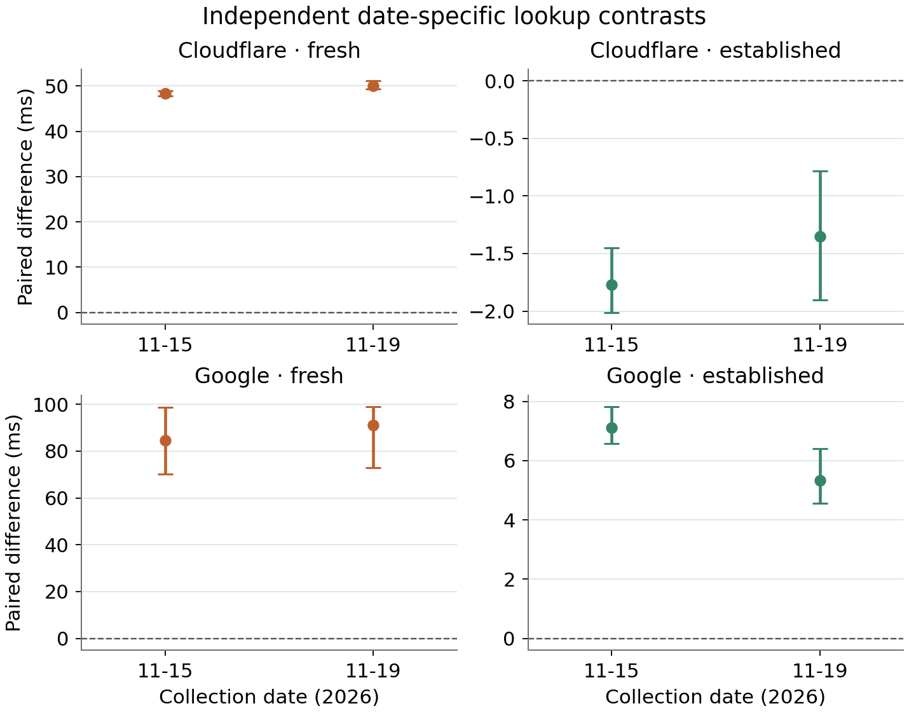
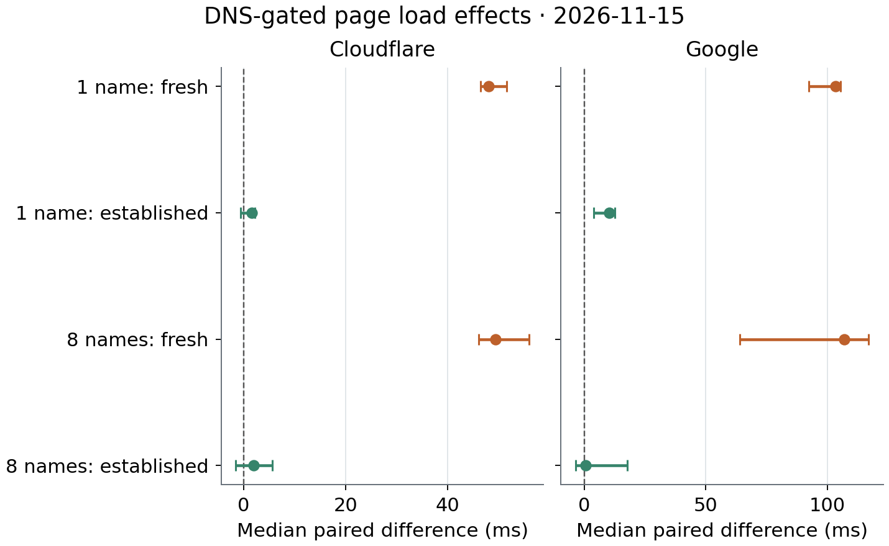

# Performance Overhead of Secure DNS

## Evaluating Lookup Latency and Page Load Impact of DNS over HTTPS Versus Standard UDP DNS

Emirhan TEKBAŞ

Student ID: 75831

Vistula University

Computer Engineering

Architecture of Computers (CII3SE003CI), 2026/2027

### Abstract

DNS over HTTPS (DoH) protects communication with a recursive resolver, but its performance depends on connection state and the surrounding workload. This study asks whether a single overhead estimate remains informative when provider choice, connection reuse and measurement time are considered explicitly. A same-provider replication compares IPv4 A queries through UDP DNS, fresh HTTP/2 DoH and established HTTP/2 DoH using Cloudflare and Google. The original session on 15 November 2026 contains 1,800 measured lookups and 360 controlled browser navigations. An independent session on 19 November repeats the workload with a different randomization seed, producing 1,800 lookups and 360 navigations. Direct wire queries bypass the operating system cache; remote recursive cache state remains unknown despite prewarming. Socket metadata verifies HTTP/2, TLS version, connection state and absence of TLS resumption. Each browser request waits for live DNS before fixed local content is delivered, with one or eight hostnames and seven images. Returned addresses are deliberately not contacted. The original median paired fresh-DoH differences were 48.4 ms for Cloudflare and 84.6 ms for Google. Established-session differences were -1.8 ms and +7.1 ms, respectively. The repeat session yielded established lookup differences of -1.3 and +5.3 ms. Google's established contrast changed sign across windows on both dates. Domain-cluster resampling, individual windows and a second collection date test how dependent the interpretation is on aggregation choices. The browser fixture demonstrates DNS gating under a fixed dependency graph, while excluding native browser resolution and remote website transfer. Connection establishment is therefore a separate experimental treatment, and an isolated lookup difference is insufficient to predict general page performance. The contribution is an auditable replication with explicit validity boundaries, rather than a new transport or a universal provider ranking.

Keywords: DNS over HTTPS; connection reuse; lookup latency; page load time; reproducibility

## Introduction and related work

DNS resolution can sit on the critical path before an application contacts a server. Conventional DNS messages commonly use UDP port 53 (Mockapetris, 1987). DoH instead maps a DNS exchange onto HTTPS, adding connection management and transport protection (Hoffman & McManus, 2018). The resulting delay includes network waits and software handling. An elapsed-time comparison cannot identify processor cycles spent on encryption. Le Louët et al. (2024), who measured resolver CPU and memory as well as response time, illustrate why those are separate outcomes.

The approved question is narrowed into three comparisons: how connection state changes same-provider lookup latency; whether the sign of an established-session contrast persists across windows and collection dates; and how DNS waiting propagates through a controlled browser resource graph. The practical decision is whether a workload can amortize HTTPS setup, rather than whether every encrypted lookup carries one fixed penalty.

Chhabra et al. (2021) studied worldwide performance using default resolvers as the conventional-DNS baseline. Changing operators can affect that comparison. Their authoritative-zone cache-miss method also differs from clearing a local cache. Böttger et al. (2019) and Hounsel et al. (2020) separated query latency from browser loading, while Hounsel et al. (2021) separated setup from established-session queries. This study re-tests those distinctions with pinned provider endpoints, paired observations and retained raw messages. It does not claim that connection reuse or same-provider controls are new discoveries.

Recent research makes protocol version and handshake policy central to interpreting secure DNS performance. Kosek et al. (2022) distinguished handshake from resolution time when comparing DoQ with HTTP/2 DoH and explicitly recorded session resumption. Sengupta et al. (2024) examined how DNS and content delivery interact when QUIC connections are coalesced, showing why application performance depends on the surrounding connection structure. Bielefeld et al. (2026) extended the comparison to resolver feature support and browser loading with DoQ and DoH over HTTP/3. These studies investigate different implementations and workloads, so their findings provide context rather than a numerical correction for this experiment. The standards also distinguish dedicated DNS over QUIC from HTTP over QUIC (Huitema et al., 2022; Bishop, 2022). Here, negotiated h2 and recorded absence of TLS resumption define a narrower treatment. HTTP/3, DoQ and cross-layer coalescing remain unmeasured. The replication therefore tests established methodological distinctions locally rather than introducing a new secure DNS mechanism.

The distinguishing evidence is the combination of verified transport treatments, observed changes of sign, two separately analyzed dates, and a browser fixture whose exclusions are explicit. A larger bibliography alone would not establish that contribution. Table and figure values are generated from saved attempts, with an offline reproduction command and a source-to-claim audit trail.

## Methodology

### Apparatus and resolver controls

Both sessions ran on a Windows 10.0.26200 x64 host reporting AMD Ryzen 7 7700 8-Core Processor, 16 logical processors and 30.9 GiB RAM. Node.js versions were v24.22.1 and v24.22.3; Chrome versions were 157.0.8103.51 and 157.0.8103.79, with Playwright 1.62.1. Full session metadata is retained. Access medium, ISP, paths and background traffic were not characterized. No CPU counters or energy measurements were taken.

Cloudflare used 1.1.1.1 with cloudflare-dns.com/dns-query; Google used 8.8.8.8 with dns.google/dns-query. DoH connected to the pinned provider address while preserving TLS hostname and certificate verification. Endpoint bootstrap was excluded. Equivalent queries requested A records over IPv4 with recursion desired, without EDNS or a DNSSEC request bit. Binary POST used application/dns-message, and HTTP/2 negotiation was required (Hoffman & McManus, 2018; Thomson & Benfield, 2022).

Provider identity and destination IP reduce operator differences but cannot prove identical anycast routes, internal front ends or recursive caches. TTL policy and distributed caching affect response time (Moura et al., 2019), while routing determines which physical anycast site a service address reaches (de Oliveira Schmidt et al., 2017). Direct messages bypass local stub-cache APIs. Before each lookup window, the ten names were primed through UDP and the persistent DoH client. This encourages reuse without proving cache hits. TTLs were saved as diagnostics. A local cache flush would not clear a public resolver's cache, and no verified recursive-cache-miss treatment is claimed.

### Lookup and browser procedures

The lookup names were example.com, wikipedia.org, mozilla.org, github.com, cloudflare.com, google.com, microsoft.com, apple.com, bbc.com and amazon.com. Each provider-name-repetition block randomized UDP, fresh DoH and established DoH. Ten repetitions in three windows yielded 300 attempts per provider-treatment condition per date. DNS windows began five minutes apart. Dates were analyzed separately. Seeds were 20261115 and 20261119; neither session was externally preregistered.

UDP timing began before socket creation. DoH timing began after message encoding and included lazy connection setup when required. Both ended after complete-response validation. Fresh lookup trials created a new TCP/TLS/HTTP/2 client per query; established trials reused a primed session for the provider and window. TLS resumption and connection state were recorded. There were no retries; connection and query stages each had a three-second timeout. These are client-and-service timings, not pure cryptographic costs.

Each page had one HTML document and seven fixed SVG images. One layout used one hostname; the other used eight. An in-flight promise memoized each hostname's live DNS request. Playwright fulfilled requests with fixed bytes after valid DNS, without contacting the returned addresses. New browser contexts blocked service workers. Fresh page DoH paid setup once per navigation and shared that connection across names; established page DoH opened and primed the connection before navigation using a name outside the fixture workload. Page hostname sets received equal UDP prewarming before each window. The exact layout and payload generator are included in the repository.

Ten randomized navigation triplets per provider and layout in three windows yielded thirty attempts per condition per date. The primary metric was loadEventEnd minus startTime, read after the load event completed (Weiss & Rosenthal, 2026). Success required seven loaded images, the expected hostname count, valid DNS and consistent connection metadata. This measures a DNS-gated fixture, not the browser's native resolver, real-site TLS or Internet content transfer.

### Validation and uncertainty

Checks covered response identity, question, response flag, opcode, truncation, response code and A answers; DoH also required HTTP 200 and the DNS media type. A second decoder audited saved query/response bytes. Per-page query numbering and unchanged connection metadata checked reuse. Failures stayed in attempt counts and were excluded only from successful-latency summaries. No timeout was imputed as a successful observation.

Medians, interquartile ranges and nearest-rank p95 describe successful attempts. The primary contrast is the median paired DoH-minus-UDP difference. Descriptive percentile intervals use 4,000 paired bootstrap samples within observed windows. Sensitivity analyses retain individual windows, omit one window at a time, and resample whole domain clusters. Resampling must respect clustered dependence, and bootstrap validity depends on the sampling model (Field & Welsh, 2007). The latter preserves within-domain dependence but has only ten clusters. No interval corrects unmeasured routing or cache bias, and dates are not pooled into a universal effect.

## Results

### Completeness and lookup distributions

Each date contains 1,800 lookup attempts and 360 navigation attempts, plus separate priming records. The original and repeat sessions recorded 0 and 0 failed measured attempts, respectively. Together they contain 3,600 measured lookups and 720 navigations. Packet and connection-treatment audits passed for the retained results. Preparatory and screenshot-only runs are excluded.

Table 1. Original-session lookup latency and paired differences in milliseconds.

| Provider | Transport | Success / attempts | Median | p95 | Paired difference [95% interval] |
|---|---|---:|---:|---:|---|
| Cloudflare | UDP | 300/300 | 19.5 | 24.2 | Baseline |
| Cloudflare | DoH fresh | 300/300 | 68.1 | 79.3 | +48.4 [+47.7, +48.9] |
| Cloudflare | DoH established | 300/300 | 17.8 | 22.5 | -1.8 [-2.0, -1.4] |
| Google | UDP | 300/300 | 36.5 | 46.2 | Baseline |
| Google | DoH fresh | 300/300 | 134.9 | 152.9 | +84.6 [+70.3, +98.8] |
| Google | DoH established | 300/300 | 43.8 | 52.8 | +7.1 [+6.6, +7.8] |

Note. Positive differences indicate slower DoH. Brackets give descriptive within-window paired-bootstrap intervals; they are not population guarantees.

Figure 1. Empirical distributions from 15 November. Fresh DoH includes connection setup. All successful observations are retained; the figure uses the recorded sample, not results from prior publications.

Fresh-DoH median paired differences were +48.4 [+47.7, +48.9] ms for Cloudflare and +84.6 [+70.3, +98.8] ms for Google. Established differences were -1.8 [-2.0, -1.4] and +7.1 [+6.6, +7.8] ms. Fresh setup and established querying therefore give substantially different contrasts.

### Window and collection-date sensitivity

Google's original established-session window differences were +9.6, -5.1, +8.7 ms. Cloudflare's were -1.3, -1.8, -1.9 ms. The Google contrast changed sign even though its pooled interval was positive. This is observed heterogeneity, not evidence identifying a cache or routing transition.

Figure 2. Original-session median paired differences by window. Positive values indicate slower DoH. Individual-window estimates expose variation concealed by a pooled median.

On 19 November, fresh-session differences were +50.1 [+49.3, +51.1] ms for Cloudflare and +91.2 [+72.9, +99.0] ms for Google. Established-session contrasts were -1.3 [-1.9, -0.8] and +5.3 [+4.6, +6.4] ms. Google's repeat-session window effects were +8.5, +10.0, -5.9 ms, again changing sign. Figure 3 retains the dates separately instead of averaging their network contexts.

Figure 3. Separately analyzed collection dates. These are date-conditioned client-and-service contrasts, not causal effects of the calendar date. The accompanying tables retain sample counts and failure information.

For the original Google established contrast, whole-domain resampling gave [+6.7, +7.5] ms. This alternative interval remains narrow despite window medians ranging from -5.1 to +9.6 ms. Changing the resampling unit therefore does not remove the temporal sensitivity. All valid values remain included.

### Controlled browser loads

Original fresh-session page differences for one/eight hostnames were 48.1/49.4 ms for Cloudflare and 103.3/107.0 ms for Google. Established-session effects were +1.6/+1.9 and +10.4/+0.7 ms, respectively.

Figure 4. Original-session paired load-event differences for one and eight hostnames. Intervals condition on the observed windows and successful page pairs. One fresh connection is shared within a page.

On the repeat date, established-session page differences for one/eight hostnames were +0.3/+0.7 ms for Cloudflare and +4.5/+9.5 ms for Google. Each effect uses matched complete page pairs; all-attempt counts remain visible in the extended results.

Full marginal, paired, domain and date-specific tables, additional graphs and the fixture screenshot are provided in the repository's extended results. Screenshots document execution and appearance; they do not replace raw measurements.

## Discussion

The fresh-versus-established distinction changes the answer substantially. A request that creates an HTTPS connection differs from a service that reuses one. A small or negative established-session contrast cannot establish that encryption accelerates DNS: routing, front ends, caching and client handling remain alternative explanations. The observed Google sign change is therefore evidence against reporting a context-free overhead, rather than evidence of a universally faster protocol.

A second collection date strengthens the audit by repeating the workload, but does not create a representative longitudinal sample. Browser and runtime metadata are retained for each session. Unmeasured access-link and routing changes can accompany the date. Agreement supports only repeatability under the sampled conditions; disagreement is reported rather than averaged away.

The browser fixture separates a mechanism from a deployment claim. Its main-document lookup precedes parsing; subsequent distinct-name lookups may overlap. Seven images therefore do not imply seven serial DNS waits. Native browsers also introduce caching, prefetching, address racing, connection coalescing and fallback, while content servers add TLS and transfer variability. The fixture removes those effects, so its observed load time cannot rank real websites or replace the native-browser measurements in Hounsel et al. (2020).

The contribution relative to a simple benchmark is inspectability: semantic query equivalence, explicit connection treatments, raw-wire validation, paired windows, a separate-date replication and alternative resampling units. It remains an introductory replication. No new protocol, global provider ordering, controlled recursive-cache treatment or processor-overhead estimate is claimed.

Relative to Chhabra et al. (2021), the narrower provider-matched baseline reduces an operator change but sacrifices global coverage and controlled cache misses. Relative to native-browser studies, fixed bytes improve control of content while limiting deployment validity. The repeated sign reversal makes these tradeoffs visible: precision within a sampled workload should not be confused with stability across network contexts. A defensible implementation recommendation is to measure the application's actual connection lifetime and dependency graph before transferring a benchmark number into a user-experience claim.

The next experiment should sample additional networks and full time-of-day cycles, verify native-browser DNS with network traces, and include HTTP/3 or DoQ as separately defined treatments. Server resource measurement would answer the architecture question raised by Le Louët et al. (2024); application latency alone cannot answer it.

## Conclusion

Fresh HTTP/2 DoH was slower than UDP at the pooled paired median for both providers on both dates. Established-session results were smaller and dependent on the sampled context. Connection state, measurement context and the resource dependency graph must accompany any reported DoH penalty. The package makes those qualifications checkable through raw evidence and one-command offline reproduction.

## Declaration of Generative AI and AI-Assisted Technologies

OpenAI Codex assisted with design, source discovery, code, measurement execution, analysis and drafting. Automated checks audited responses and recalculated results. The submitting author remains responsible for independent verification, understanding and the final interpretation.

## Data and code availability

Code, raw measurements, environment metadata, figures and execution evidence: https://github.com/EmirHAN60/secure-dns-research. Original and replication data remain separate. Metadata, raw data and executable analysis follow established networking reproducibility guidance (Bajpai et al., 2019).

## References

Bajpai, V., Brunstrom, A., Feldmann, A., Kellerer, W., Pras, A., Schulzrinne, H., Smaragdakis, G., Wählisch, M., & Wehrle, K. (2019). The Dagstuhl beginners guide to reproducibility for experimental networking research. *ACM SIGCOMM Computer Communication Review, 49*(1), 24–30. https://doi.org/10.1145/3314212.3314217

Bielefeld, P., Hoffmann, F., Sassalla, S., ververis, v., & Bajpai, V. (2026). The future of DNS privacy: A comparison of DNS over QUIC and DNS over HTTP/3. In S. Ferlin-Reiter, R. Fontugne, & J. Ullrich (Eds.), *Passive and active measurement* (pp. 202–228). Springer. https://doi.org/10.1007/978-3-032-18268-5_10

Bishop, M. (Ed.). (2022). *HTTP/3* (RFC 9114). RFC Editor. https://doi.org/10.17487/RFC9114

Böttger, T., Cuadrado, F., Antichi, G., Fernandes, E. L., Tyson, G., Castro, I., & Uhlig, S. (2019). An empirical study of the cost of DNS-over-HTTPS. In *Proceedings of the Internet Measurement Conference* (pp. 15–21). Association for Computing Machinery. https://doi.org/10.1145/3355369.3355575

Chhabra, R., Murley, P., Kumar, D., Bailey, M., & Wang, G. (2021). Measuring DNS-over-HTTPS performance around the world. In *Proceedings of the 21st ACM Internet Measurement Conference* (pp. 351–365). Association for Computing Machinery. https://doi.org/10.1145/3487552.3487849

de Oliveira Schmidt, R., Heidemann, J., & Kuipers, J. H. (2017). Anycast latency: How many sites are enough? In M. A. Kaafar, S. Uhlig, & J. Amann (Eds.), *Passive and active measurement* (pp. 188–200). Springer. https://doi.org/10.1007/978-3-319-54328-4_14

Field, C. A., & Welsh, A. H. (2007). Bootstrapping clustered data. *Journal of the Royal Statistical Society: Series B (Statistical Methodology), 69*(3), 369–390. https://doi.org/10.1111/j.1467-9868.2007.00593.x

Hoffman, P., & McManus, P. (2018). *DNS queries over HTTPS (DoH)* (RFC 8484). RFC Editor. https://doi.org/10.17487/RFC8484

Hounsel, A., Borgolte, K., Schmitt, P., Holland, J., & Feamster, N. (2020). Comparing the effects of DNS, DoT, and DoH on web performance. In *Proceedings of The Web Conference 2020* (pp. 562–572). Association for Computing Machinery. https://doi.org/10.1145/3366423.3380139

Hounsel, A., Schmitt, P., Borgolte, K., & Feamster, N. (2021). Can encrypted DNS be fast? In O. Hohlfeld, A. Lutu, & D. Levin (Eds.), *Passive and active measurement* (pp. 444–459). Springer. https://doi.org/10.1007/978-3-030-72582-2_26

Huitema, C., Dickinson, S., & Mankin, A. (2022). *DNS over dedicated QUIC connections* (RFC 9250). RFC Editor. https://doi.org/10.17487/RFC9250

Kosek, M., Schumann, L., Marx, R., Doan, T. V., & Bajpai, V. (2022). DNS privacy with speed? Evaluating DNS over QUIC and its impact on web performance. In *Proceedings of the 22nd ACM Internet Measurement Conference* (pp. 44–50). Association for Computing Machinery. https://doi.org/10.1145/3517745.3561445

Le Louët, E., Blin, A., Sopena, J., Haddadou, K., & Amaou, A. (2024). Effects of secured DNS transport on resolver performance. *ITU Journal on Future and Evolving Technologies, 5*(1), 47–61. https://doi.org/10.52953/NUXL5710

Mockapetris, P. (1987). *Domain names—Implementation and specification* (RFC 1035). RFC Editor. https://doi.org/10.17487/RFC1035

Moura, G. C. M., Heidemann, J., Schmidt, R. de O., & Hardaker, W. (2019). Cache me if you can: Effects of DNS time-to-live. In *Proceedings of the Internet Measurement Conference* (pp. 101–115). Association for Computing Machinery. https://doi.org/10.1145/3355369.3355568

Sengupta, J., Kosek, M., Fries, J., Ferlin-Reiter, S., & Bajpai, V. (2024). On cross-layer interactions of QUIC, encrypted DNS and HTTP/3: Design, evaluation, and dataset. *IEEE Transactions on Network and Service Management, 21*(3), 2992–3007. https://doi.org/10.1109/TNSM.2024.3383787

Thomson, M., & Benfield, C. (Eds.). (2022). *HTTP/2* (RFC 9113). RFC Editor. https://doi.org/10.17487/RFC9113

Weiss, Y., & Rosenthal, N. (Eds.). (2026, November 2). *Navigation timing level 2* (W3C Working Draft). World Wide Web Consortium. https://www.w3.org/TR/2026/WD-navigation-timing-2-20261102/
